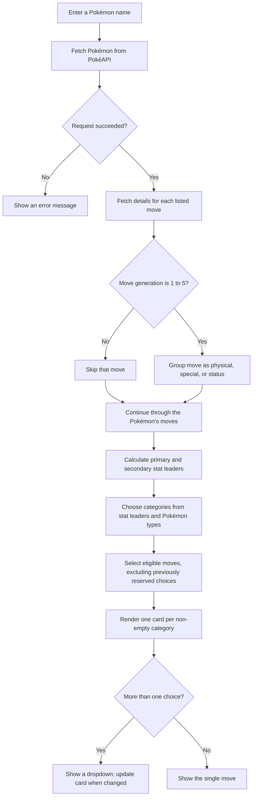
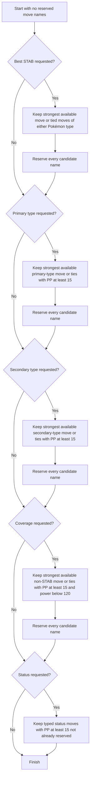

# [Pokémon Moves Generator](https://veyronshark.github.io/PokeMMO-Moves-Generator/)

A small browser-based moveset suggestion tool. Enter a Pokémon's name to fetch its stats, types, and move data from [PokéAPI](https://pokeapi.co/). The app uses the Pokémon's strongest stats and types to choose move categories, then displays the suggestions as stacked cards. If a category has multiple equally ranked candidates, choose between them in its dropdown.

> **This is a heuristic, not a battle simulator.** The suggestions are based on base stats, move type, power, and PP filters. They do not calculate type effectiveness, STAB damage, move accuracy expectations, abilities, items, or team strategy.

## Run it

Open `index.html` in a modern browser with an internet connection. No build step or package installation is required; the browser calls PokéAPI directly.

## How a search works



Move details are requested one at a time. A move is skipped when the generation number in its PokéAPI URL is greater than 5, so the pool is restricted to generations 1–5. The displayed description is the English flavor text for the `black-white` version group when available.

## Stat calculations

The program reads the Pokémon's base stats and calculates:

```text
average defense = floor((defense + special defense) / 2)
primary leaders = every stat tied for max(attack, special attack, average defense)
secondary leaders = every stat tied for max(HP, speed)
```

All ties are kept. For example, a tie between Attack and Special Attack enables both physical and special moves during selection. If the only primary leader is average defense, both attack classes are considered so the defensive stat can still produce an offensive recommendation.

These leaders influence the category format:

| Pokémon type count | Initial categories |
| --- | --- |
| One type | Primary-type move, then best STAB |
| Two types | Primary-type move, then secondary-type move |

The remaining format depends on the leading stats:

- If average defense is a primary leader, add status and coverage categories.
- Otherwise, add coverage. Dual-type Pokémon also get a best-STAB category. Single-type Pokémon get status when Speed is a secondary leader; otherwise the format adds coverage again (the selector only emits one coverage category).

## Move selection rules

The selector processes categories in a fixed order: **best STAB → primary type → secondary type → coverage → status**. It only runs a category if that category is in the format.



| Category | Eligible moves | Ranking |
| --- | --- | --- |
| **Best STAB** | Physical/special moves whose type matches either of the Pokémon's types | Highest power |
| **Primary type** | Physical/special moves matching the first Pokémon type, with at least 15 PP | Highest power |
| **Secondary type** | Physical/special moves matching the second Pokémon type, with at least 15 PP | Highest power |
| **Coverage** | Physical/special moves not matching the Pokémon's types, with at least 15 PP and power below 120 | Highest power; Normal moves are sorted after other types |
| **Status** | Status moves matching either Pokémon type, with at least 15 PP | All eligible moves (no power ranking) |

“Strongest” means the maximum `power` value among eligible moves; every move tied at that maximum is included as an option. The dropdown is shown when a category has more than one candidate. Categories with no candidates are omitted from the cards.

### Avoiding repeated attacks

Every candidate selected for a category is added to a set of reserved move names. Later categories filter out all reserved names before ranking. This reserves **every tied dropdown option**, not only the first or currently displayed option, so the same attack cannot be suggested again lower in the list. Status moves also respect the reserved-name set.

## Interface

- One long, thin card is rendered for each non-empty category, in a vertical stack.
- Multiple choices appear in a dropdown; a single choice is displayed directly.
- Choosing a different option updates the card's move name, type, class, power, accuracy, and PP.
- The move's type controls the card accent and tint, and the dropdown options are colored by their own move types.
- A move's English Black/White flavor text is available as the card's hover tooltip.
- The layout adapts for narrow screens, and loading and errors are announced in the page.

## Project files

| File | Responsibility |
| --- | --- |
| `index.html` | Search form, status message, and results container |
| `script.js` | PokéAPI requests, stat calculations, move filters, and rendering |
| `styles.css` | Responsive layout, move cards, and type-based colors |
